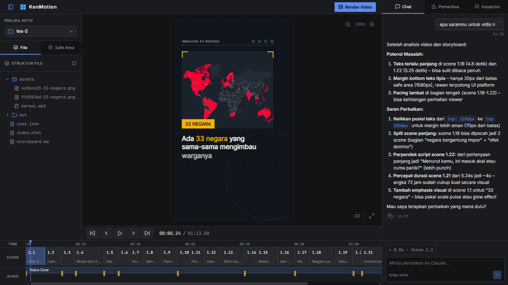

# KenMotion Studio

Aplikasi studio workstation lokal untuk memeriksa, memodifikasi (*live inspector & Claude AI*), dan merender animasi vertikal (9:16) berbasis HTML motion dari `storyboard.md` menjadi video MP4 berkualitas tinggi.



Ditenagai oleh **Bun**, **Vue 3 + Vite**, **Hono**, **Playwright (Chromium)**, dan **ffmpeg**.

---

## 🚀 Cara Menjalankan Cepat (One-Click Launch)

### Mode Produksi (Sangat Ringan — Rekomendasi Penggunaan)
Anda tidak perlu membuka terminal atau menjalankan server dev manual. Cukup:
1. **Klik ganda file `start.bat`** di folder root proyek.
2. Browser akan otomatis terbuka ke:
   ```
   http://127.0.0.1:3031
   ```
*Keunggulan mode ini:*
- **Satu Proses Tunggal:** Hanya server Bun + Hono yang berjalan (~30–50 MB RAM).
- **Tanpa Server Vite:** Bebas proses latar belakang dan beban compiler saat menggunakan aplikasi.
- **Deteksi Otomatis:** Jika folder build `apps/web/dist` belum ada, `start.bat` otomatis melakukan build pertama kali.

---

### Mode Pengembangan (Development / Editing Kode KenMotion)
Gunakan mode ini jika Anda ingin memodifikasi kode aplikasi KenMotion (Vue components atau rute Hono):
```bash
bun run dev
```
Perintah ini akan menjalankan HMR Vite frontend di port `5757` dan backend API Hono di port `3031` secara paralel.

---

## 🎬 Alur Kerja Produksi Video (Workflow)

```
1. Buat Folder Projek (projects/:id)
   ├── storyboard.md           (Tabel adegan, timeline & script)
   ├── assets/                 (Aset visual & narasi.mp3 — tanpa subfolder)
   └── cues.json (opsional)    (Sinkronisasi SFX dari SFX.md)
              │
              ▼
2. Agen AI / Kreator membuat index.html
   (Mematuhi kontrak SPEC.md, safe area, dan GSAP timeline)
              │
              ▼
3. Buka KenMotion Studio (http://127.0.0.1:3031)
   ├── Preview & Scrubber      (Sinkronisasi frame & timeline)
   ├── Tab Pemeriksa (Slop)    (Audit otomatis safe area, typo script, & font)
   ├── Tab Chat (Claude CLI)   (Prompt perbaikan AI interaktif dengan preview auto-reload)
   └── Tab Inspector           (Override visual non-destruktif via fixes.json)
              │
              ▼
4. Render Video Final (.mp4)
   (Playwright frame-capture + ffmpeg mixing musik & audio ducking)
```

---

## 📁 Struktur Direktori

```
KenMotion/
├── apps/
│   ├── web/                     # Frontend Vue 3 + TypeScript
│   │   ├── src/
│   │   │   ├── components/      # Chat, Pemeriksa, Preview, Sidebar, Timeline
│   │   │   ├── composables/     # State Player, Audio, Fixes, Chat, Render
│   │   │   └── styles/          # Design Tokens (tokens.css)
│   │   └── dist/                # Hasil build produksi statis
│   └── server/                  # Backend Hono + Bun (Port 3031)
│       └── src/
│           ├── routes/          # projects, check, render, audio, library, fixes, chat
│           └── services/        # playwright, ffmpeg, claude bridge, audio mixing
├── library/                     # Aset Pustaka Bersama (Shared Assets)
│   ├── vendor/                  # GSAP (/library/vendor/gsap.min.js)
│   ├── fonts/                   # Plus Jakarta Sans, Inter, JetBrains Mono
│   └── audio/                   # BGM & SFX global (referensi nama dari SFX.md)
├── projects/                    # Folder Seluruh Projek Motion
│   ├── ted/                     # Contoh projek explainer 33 negara
│   └── tes/                     # Contoh projek custom
├── SPEC.md                      # Kontrak teknis wajib HTML motion
├── SAFE-AREA.md                 # Standar area aman vertikal TikTok/Reels/Shorts
├── SFX.md                       # Katalog pustaka nama & karakter sound effects
├── ROADMAP.md                   # Tahapan pengembangan & status fitur
└── start.bat                    # Script launcher 1-klik Windows
```

---

## 📋 Kontrak Teknis (`SPEC.md` Ringkas)

Setiap projek motion di folder `projects/:id/` harus mematuhi aturan berikut agar kompatibel dengan sistem preview, pemeriksa slop, dan renderer:

1. **Kanvas Tetap:** Resolusi vertikal 9:16 (`1080 × 1920`), elemen induk `#stage`.
2. **Library Bersama:** 
   - GSAP wajib dimuat dari: `<script src="/library/vendor/gsap.min.js"></script>`
   - Font dimuat dari: `/library/fonts/nama-font.woff2`
3. **Aset Proyek Datar (Flat Structure):**
   - Seluruh aset visual (`.png`, `.jpg`, `.mp4`) dan audio proyek diletakkan langsung di `assets/` tanpa subfolder (misal `assets/gambar.png`, `assets/narasi.mp3`).
4. **Atribut Scene:**
   - Setiap babak adegan memiliki atribut `data-scene="1.x"`, `data-start="0.0"`, `data-end="3.5"`, dan teks narasi wajib diberi penanda `data-script` persis sama dengan storyboard.
5. **Kontrak JavaScript:**
   - `window.__duration = 73.3;` (detik)
   - `window.__seek = (t) => { ... };` (pindah tampilan deterministik ke detik t)
   - `window.__ready = Promise.resolve();` (menunggu font/aset termuat)
6. **SFX Audio Cues:**
   - Didefinisikan di `cues.json` menggunakan daftar nama file standar dari [`SFX.md`](./SFX.md) (misal `whoosh-fast.wav`, `hit-sub-bass.wav`).

---

## 🛠️ Perintah CLI Berguna

| Perintah | Fungsi |
|---|---|
| `start.bat` | Menjalankan aplikasi mode produksi dan membuka browser otomatis |
| `bun run build` | Mengompilasi frontend Vue ke `apps/web/dist` |
| `bun run start` | Menjalankan server tunggal produksi Hono di `127.0.0.1:3031` |
| `bun run dev` | Menjalankan mode dev (Vite + Hono paralel dengan HMR) |
| `bun run typecheck` | Menjalankan validasi TypeScript ketat pada frontend & backend |

---

## 💡 Fitur Unggulan Studio
- **Anti-404 Project Guard:** Navigasi antarmuka mengingat pilihan projek via URL param & localStorage, dengan auto-fallback jika folder projek dihapus dari disk.
- **Realtime Project Discovery:** Dropdown pemilih projek langsung membaca daftar folder di Windows Explorer secara *live* tanpa perlu refresh browser.
- **Slop Audit Engine:** Memindai canvas secara otomatis untuk mendeteksi teks keluar batas aman (*safe area overflow*), ketidaksesuaian naskah, atau kegagalan pemuatan font.
- **Claude Assistant Stream:** Chat panel terintegrasi langsung dengan Claude CLI untuk iterasi perbaikan kode secara instan.
- **Frame-Accurate MP4 Renderer:** Memanfaatkan Playwright headless screenshot per milidetik yang di-pipe langsung ke ffmpeg dengan audio ducking otomatis.
